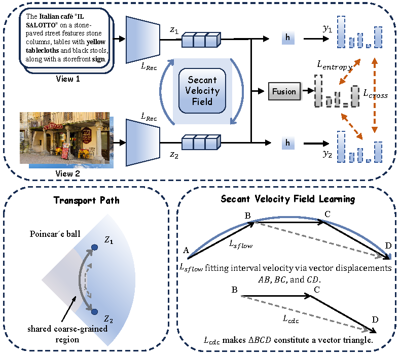

<p align="center">
  <b>English</b> | <a href="docs/README_zh.md">中文</a>
</p>

<div align="center">

<h2>[Under Review] 💫 Hyperbolic Geodesic Secant Flow for Incomplete Multi-View Representation Learning</h2>

[Yiteng Yuan]()<sup>1</sup>, [Chang Tang]()<sup>1</sup>, [Lianbo Guo]()<sup>1</sup>

<sup>1</sup>[Huazhong University of Science and Technology](https://www.hust.edu.cn/)

</div>

***

Welcome to the official implementation of **HGSF** (Hyperbolic Geodesic Secant Flow), an incomplete multi-view representation learning (IMVRL) framework. HGSF recovers missing views by transporting latent representations along **hyperbolic geodesics** instead of Euclidean chords:

- a **data-calibrated Poincaré ball** provides the transport geometry, so the path follows the tree-like organization that the latent space spontaneously forms during cross-view consistency training;
- closed-form **Möbius geodesics** serve as transport paths (O(d) per evaluation, no iterative solver, no learnable path parameters);
- an **interval secant velocity field** decouples the truncation error from path curvature, and a **cumulative displacement consistency (CDC)** loss keeps few-step integration self-consistent along the same geodesic;
- the field is **invertible**, so a single network supports bidirectional completion.

The pipeline is agnostic to the number of views: two views proceed directly (clustering / classification), and three views (local / neighbor / global H&E embeddings) support **gene expression prediction** on spatial transcriptomics.


### Overview
<p align="center">
  
</p>


### 📑 Table of Contents

- [🔗 Citation](#-citation)
- [1. ✅ Run](#1--run)
  - [1.1 Source code list](#11-source-code-list)
- [2. 🧮 Main Code](#2--main-code)
  - [2.1 Configuration](#21-configuration)
  - [2.2 Hyperparameters](#22-hyperparameters)
  - [2.3 Data Pipeline & Missing-View Simulation](#23-data-pipeline--missing-view-simulation)
  - [2.4 Outputs](#24-outputs)
- [3. 🔬 Loss](#3--loss)
- [4. 🧩 Method Overview](#4--method-overview)
- [5. 📊 Dataset](#5--dataset)
  - [5.1 Spatial Transcriptomics Benchmarks](#51-spatial-transcriptomics-benchmarks)
  - [5.2 Three-View Construction & Gene Panel](#52-three-view-construction--gene-panel)
  - [5.3 Legacy Multi-View `.mat` Format (Clustering)](#53-legacy-multi-view-mat-format-clustering)
  - [5.4 Evaluation Metrics](#54-evaluation-metrics)
- [6. 💻 User Guide](#6--user-guide)
  - [6.1 Requirements](#61-requirements)
  - [6.2 HuggingFace Token](#62-huggingface-token)
  - [6.3 Device Selection](#63-device-selection)
  - [6.4 Platform Notes](#64-platform-notes)
- [7. 🙏 Acknowledgments](#7--acknowledgments)

---

## 1. ✅ Run

Put your HuggingFace token into `dataset_download_hest1k.py` and `preprocess.py` (see [6.2](#62-huggingface-token)), then:

```shell
python dataset_download_hest1k.py   # download HEST v1.1.0 -> /data/hest1k_datasets/{her2st,cSCC,PRAD,DLPFC}
python preprocess.py                # UNI embeddings (local/neighbor/global) + ~200-gene panel + slide list
python train.py                     # train HGSF on all four datasets -> HGSF_all_datasets_summary.csv
```

To run a **single dataset** or **multiple seeds**, edit the two lines at the bottom of `train.py`:

```py
test_time = 1                                   # >1 repeats with perturbed seeds; the summary reports the mean
run_all(dataset_cfgs=DATASETS, test_time=test_time)
# single dataset, e.g. her2st: run_all(dataset_cfgs=[DATASETS[3]], test_time=1)
```

The terminal output is organized into labeled blocks:

- `[Data]` per-dataset loading info (view shapes, kept spots after filtering all-NaN / all-zero spots);
- `[run k]` missing simulation summary (`complete samples: x/N`), model parameter count;
- `[auto_curv]` curvature calibration logs; `[ball]` in-ball monitoring every 10 epochs;
- per-eval line `Epoch: e/200 ==> loss | vel (CDC) | val PCC (best)`;
- a final per-dataset block (complete / missing metrics) and a cross-dataset summary table saved to `HGSF_all_datasets_summary.csv`.

### 1.1 Source code list

```shell
HGSF
├── config.py                     # CFG (global hyperparams) + DATASETS registry + legacy clustering configs
├── dataset_download_hest1k.py    # HEST v1.1.0 download (HuggingFace MahmoodLab/hest)
├── preprocess.py                 # UNI patch embeddings + common genes + gene-panel selection
├── models.py                     # Autoencoder / ClusterProject / ProjectionHead / CrossViewNTXent / MultiViewAttention / ...
├── flow.py                       # FlowNet + FlowScheduler (Poincaré-ball ops, secant loss, CDC, Euler integration)
├── losses.py                     # MMI / ClusterLoss / CLoss / IMCClusterLoss / entropy / log_center
├── utils.py                      # seeding, missing masks (get_mask / get_mask_icdm), batching, clustering metrics
├── data.py                       # load_spa_data (three-view SPA) + legacy .mat loader
├── metrics.py                    # PCC / PCC-k / SpotPCC / MAE / MSE / RVD + CSV aggregation
├── visualization.py              # scatter, histograms, spatial maps, training curves, comparisons
└── train.py                      # HGSF model class + main() / run_all() entry
```

---

## 2. 🧮 Main Code

### 2.1 Configuration

The dataset registry and output naming are handled automatically (`config.py`):

```py
DATA_ROOT = "/data/hest1k_datasets"      # unified (anonymized) data root; change here if needed

DATASETS = [                             # slide naming = prefix + number
    dict(expr_name="DLPFC",  prefix="MISC", slide_out="MISC1",   data_path=f"{DATA_ROOT}/DLPFC/"),
    dict(expr_name="PRAD",   prefix="MEND", slide_out="MEND139", data_path=f"{DATA_ROOT}/PRAD/"),
    dict(expr_name="cSCC",   prefix="NCBI", slide_out="NCBI759", data_path=f"{DATA_ROOT}/cSCC/"),
    dict(expr_name="her2st", prefix="SPA",  slide_out="SPA119",  data_path=f"{DATA_ROOT}/her2st/"),
]
```

- `slide_out` is the **held-out test slide(s)**; it accepts comma-separated lists for multi-slide holdout (e.g. `"MISC1,MISC2"`).
- All outputs of one dataset go to `./{expr}_HGSF_results/{first_slide}/`; `run_all` additionally writes `./HGSF_all_datasets_summary.csv`.
- `CFG.gpu` presets `CUDA_VISIBLE_DEVICES` inside `train.py`.
- Legacy clustering configurations (`get_default_config`) cover CUB / LandUse-21 / Scene15 / HandWritten / Synthetic3d / Multi-Fashion for the IMVC experiments of the paper.

### 2.2 Hyperparameters

Key fields of `CFG` (all in `config.py`):

```py
# ---- Data ----
missing_rate = 0.5        # simulated view missingness (train & test)
val_ratio    = 0.1        # spot-level validation split within training slides
log_y        = True       # log2(x+1) transform of gene expression
zscore_y     = True       # gene-wise standardization (train statistics shared with test)

# ---- Network ----
latent_dim   = 128        # shared latent dimension d
hidden       = 1024       # autoencoder width
n_clusters   = 128        # ClusterProject head size (used by the entropy weighting)

# ---- Training ----
lr           = 1e-4       # Adam
batch_size   = 256
train_epochs = 200
seed         = 0

# ---- Flow / Poincaré ball ----
flow_num_steps  = 1       # Euler step budget (set to 10 for the multi-step secant configuration of the clustering experiments)
flow_beta_t     = 0.5     # t ~ Beta(β, β); β=0.5 follows the arcsine law
flow_symmetric  = True    # random ordered view pairs -> bidirectional supervision
flow_curv       = 1e-9    # initial curvature ≈ 0 (Euclidean chords during warm-up)
flow_auto_curv  = True    # data-driven curvature calibration
flow_auto_curv_target = 0.9      # target ball occupancy s*
flow_auto_curv_epochs = [3, 30]   # calibration points (after the warm-up)
flow_ball_eps   = 1e-4    # tail projection margin

# ---- CDC (cumulative displacement consistency, L_cdc) ----
vel_warmup_epoch = 20     # L_cdc activated after this epoch
cdc_num_steps    = 10     # N in L_cdc (h = 1/N)

# ---- Loss weights [L_sflow, L_cdc, L_ntxent, L_entropy] ----
lamda_List = [[1.0, 1.0, 1.0, 1.0]]

# ---- Regression probe ----
reg_alpha = 10.0          # Ridge α on the fused representation (StandardScaler + Ridge)

# ---- Plotting / diagnostics ----
spatial_topk = 5          # genes drawn as spatial true-vs-predicted maps
topk_bar     = 20         # genes in the per-gene PCC bar chart
run_diagnostics = False   # True: FLOPs + inference-time profiling (needs thop)
```

### 2.3 Data Pipeline & Missing-View Simulation

```py
# preprocess.py (run once per dataset)
# 1) read per-slide h5ad files           -> common gene set across slides
# 2) UNI (ViT-L/16) embeddings of 224x224 spot-centered H&E patches
#       local    [N, 1536]      (query spot)
#       neighbor [N, 9, 1536]   (9-spot neighborhood, query spot included)
#       global   [N, 49, 1536]  (49-spot region, query spot included)
# 3) gene panel: union HVG (2000/slide) -> top-300 by mean ∩ top-300 by std -> ~200 genes
# 4) outputs under processed_data/: {local,neighbor,global}_ebd/{slide}.pt,
#       selected_gene_list.txt, all_slide_lst.txt

# train.py (per run)
# 5) log2(x+1) + gene-wise z-score (mu/sd fitted on training slides only)
# 6) neighbor/global views aggregated by mean (neighbor_mode / global_mode = 'mean')
# 7) get_mask(view_num, N, missing_rate, seed): independent Bernoulli missingness
#       per view with missing_rate = 0.5; every spot keeps at least one observed view
#       (missing-view features are zeroed)
# 8) test scenarios: complete (all three views) vs missing (same simulation, seed+1000)
```

### 2.4 Outputs

All files of one dataset run share the directory `./{dataset}_HGSF_results/{slide}/`; `{tag}` is `MR0.5_complete` / `MR0.5_missing` (a `_s{k}` suffix is appended when `test_time > 1`).

| File / Figure | Contents |
|---|---|
| `metrics.csv` | per-run metrics appended row by row (dataset, MR, seed, eval, all statistics) |
| `per_gene_metrics_{tag}.csv` | per-gene PCC / RVD / MSE / MAE |
| `pred_{tag}.npy` | predicted log2 expression on the held-out slide(s) |
| `test_y.npz` | ground truth (z-scored + log2), standardization statistics, gene names |
| `summary_metrics.json` | per-run and mean metrics |
| `fig_scatter_{tag}.png` | hexbin predicted vs true (log2) with global PCC |
| `fig_pcc_hist_{tag}.png` / `fig_spotpcc_hist_{tag}.png` | per-gene / per-spot PCC histograms |
| `fig_rvd_hist_{tag}.png` / `fig_rvd_vs_pcc_{tag}.png` | variance-fidelity diagnostics (RVD histogram, RVD vs PCC) |
| `fig_top_genes_{tag}.png` | top-k genes by per-gene PCC |
| `fig_spatial_{gene}_{tag}.png` | true vs predicted spatial maps for the top genes |
| `fig_train_loss_{k}{sfx}.png` | per-component loss curves: `rec / flow / vel (CDC) / cluster / entropy / rad / comp / total` |
| `fig_val_pcc{sfx}.png` | validation gene-PCC during training |
| `fig_compare_{m}.png` | complete-vs-missing comparison bars per metric |
| `./HGSF_all_datasets_summary.csv` | cross-dataset summary produced by `run_all` |

---

## 3. 🔬 Loss

The overall objective follows Eq. (22) of the paper, with two additional small-weight geometry terms implemented as separate slots:

```
L = L_rec + λ1·L_sflow + λ2·L_cdc + λ3·L_cross + λ4·L_entropy,
L_cross = L_clu (cross-view NT-Xent) + λ_r·L_rad (radius consistency)
```

| Term | `loss_hist` key | Weight (default) | Role |
|---|---|---|---|
| Within-view reconstruction | `rec` | 1 (fixed) | view-specific autoencoders on complete samples |
| Secant flow | `flow` | λ1 = 1.0 | interval secant residual on the calibrated geodesic |
| Cumulative displacement consistency | `vel` | λ2 = 1.0 | closed vector triangle along the geodesic (N = 10; active after epoch 20) |
| Semantic consistency | `cluster` | λ3 = 1.0 | cross-view NT-Xent on a SimCLR-style projection head (τ = 0.5) |
| Radius consistency | `rad` | λ_r = 1e-4 | aligns the latent norms (radial coordinates) of paired views |
| Post-completion semantic consistency | `comp` | λ = 1e-4 | NT-Xent between flow-completed representations; gradients propagate back into the secant field |
| Entropic alignment | `entropy` | λ4 = 1.0 | KL(fused ‖ y*) with entropy-weighted clr-space fusion |

Optimization is effectively **two-stage**: the curvature starts at ≈ 0 (Euclidean straight paths) while the autoencoders and the semantic/entropy objectives form the common latent space; after data-driven calibration (epochs 3 and 30) the transport switches to calibrated hyperbolic geodesics, and L_cdc joins from epoch 20.

---

## 4. 🧩 Method Overview

HGSF is built on three core design axes and one end-to-end pipeline:

**① Tree-like latent organization (motivation).** Cross-view consistency training spontaneously organizes the latent space into a tree-like hierarchy: the latent norm is strongly correlated with the dendrogram height (low-norm latents = shallow, coarse clusters). This is verified by a high cophenetic correlation, a Gromov relaxation ratio well below the Gaussian null across kNN scales, and negligible H1 persistence (Section 3.1 of the paper).

**② Calibrated Poincaré ball (path axis).** The curvature is calibrated from the observed latent norms (high quantile + safety margin, target ball occupancy 0.9), so the conformal factor is uniformly bounded and the geometry is invariant to global rescaling. Closed-form Möbius geodesics bend toward the origin — the coarse-grained center — and stay within the data support, whereas Euclidean chords cut across low-support structural gaps (verified on > 99% of endpoint pairs, Properties 1–2).

**③ Interval secant field + CDC (field axis).** The velocity field matches **interval secant mean velocities** instead of instantaneous tangents: a matched Euler step lands exactly on the path, so the truncation error is decoupled from curvature (‖x_N − z2‖ ≤ (e^L − 1)/L · ε, no curvature term, no explicit N). The **cumulative displacement consistency loss** additionally requires that predictions from different starting points agree on one endpoint, keeping few-step integration self-consistent; since the continuous-time flow is invertible, a single network supports bidirectional completion via time/sign reversal.

**④ End-to-end completion pipeline.** V view-specific autoencoders map heterogeneous views into a common 128-d latent space (L_rec); cross-view NT-Xent + radius consistency align angular and radial coordinates (L_cross); entropy-weighted clr-space fusion produces the fused prediction (L_entropy). At inference, a missing view is imputed by **averaging the flow integration over the present, supervised views** (observed latents are projected into the ball); the fused representation feeds a Ridge probe (α = 10) for gene expression prediction, and K-means / a linear SVM probe for clustering / classification.

---

## 5. 📊 Dataset

### 5.1 Spatial Transcriptomics Benchmarks

All four datasets come from **HEST v1.1.0** (`MahmoodLab/hest`, downloaded by `dataset_download_hest1k.py`) and pair H&E images with spatially resolved gene expression:

| Dataset | Tissue | Platform | Slides | Spots | Measured Genes | Held-out Test Slide |
|---|---|---|---|---|---|---|
| Her2st | breast cancer | Spatial Transcriptomics | 36 | 13,620 | 11,871 | SPA119 |
| cSCC | cutaneous squamous cell carcinoma | Spatial Transcriptomics | 12 | 12,255 | 13,251 | NCBI759 |
| PRAD | prostate cancer | Spatial Transcriptomics | 26 | 62,710 | 33,538 | MEND139 |
| DLPFC | dorsolateral prefrontal cortex (non-cancer) | 10x Visium | 12 | 47,681 | 33,538 | MISC1 |

We adopt a **slide-level holdout** protocol shared by all compared methods: the held-out slide(s) are removed from the training list and used only for final testing; validation is spot-level (10% of the training spots). Expected layout after download + preprocessing:

```
/data/hest1k_datasets/
├── her2st/   (st/*.h5ad, wsis/*.tif, processed_data/{local,neighbor,global}_ebd/, gene & slide lists)
├── cSCC/
├── PRAD/
└── DLPFC/
```

### 5.2 Three-View Construction & Gene Panel

Following the SPA protocol, each spot is described by three H&E-derived views extracted with **UNI** (ViT-L/16):

- **local view**: the query spot's own 224×224 patch embedding;
- **neighbor view**: mean embedding of the 9-spot neighborhood (query spot included);
- **global view**: mean embedding of the larger 49-spot region (query spot included).

The gene panel is a fixed set of ≈ 200 genes shared across all slides: union HVG (2000 per slide, after `normalize_total` + `log1p`) → intersection of the top-300 mean-expressed and top-300 std-expressed genes. Expression is transformed by log2(x+1) and standardized with training-split statistics.

### 5.3 Legacy Multi-View `.mat` Format (Clustering)

The clustering experiments of the paper use conventional multi-view benchmarks packed as single `.mat` files:

- `X`: a MATLAB cell array of view matrices, `X{1}, X{2}, ...`, each of shape `(num_samples, num_dims)`;
- `Y`: a `(num_samples, 1)` integer label vector.

Missing views are simulated either by `utils.get_mask` (per-view Bernoulli, SPA version) or `utils.get_mask_icdm` (indicator matrix iteratively approaching the exact missing rate), and clustering quality is reported as ACC / NMI / ARI with Hungarian (Munkres) label matching (`utils.evaluation`).

### 5.4 Evaluation Metrics

Gene expression prediction (main pipeline) — all computed in log2 space by `metrics.compute_metrics`:

```python
PCC            # mean per-gene Pearson correlation between predicted and true expression
PCC-10/50/200  # PCC restricted to the k most highly expressed genes (by mean ground truth)
SpotPCC        # mean per-spot PCC
MAE / MSE      # absolute / squared error over all genes and spots
RVD            # per-gene |std_pred − std_true| / std_true (relative variance deviation)
```

Clustering (legacy pipeline): ACC / NMI / ARI on the K-means clustering of the fused representation, higher is better.

---

## 6. 💻 User Guide

### 6.1 Requirements

| Library | Tested | Purpose |
|---|---|---|
| python | 3.9+ | runtime environment |
| pytorch | 2.x (cu121) | networks & training (single RTX 4090 in the paper) |
| scanpy / anndata | ≥ 1.10 | h5ad reading, HVG selection |
| timm | ≥ 1.0 | UNI backbone (`hf-hub:MahmoodLab/uni`) |
| huggingface_hub / datasets | latest | HEST download, UNI weights |
| numpy / pandas / scipy | ≥ 1.21 | data handling & metrics |
| scikit-learn | ≥ 1.0 | StandardScaler + Ridge probe, clustering metrics |
| munkres | — | cluster-label alignment (legacy pipeline) |
| matplotlib | — | all figures |
| thop *(optional)* | — | FLOPs profiling (`CFG.run_diagnostics = True`) |

### 6.2 HuggingFace Token

Both `dataset_download_hest1k.py` and `preprocess.py` call `huggingface_hub.login(...)`. Paste your User Access Token from <https://huggingface.co/settings/tokens> — it is required to access `MahmoodLab/hest` (dataset) and `MahmoodLab/uni` (backbone).

### 6.3 Device Selection

- `train.py` presets `CUDA_VISIBLE_DEVICES` from `CFG.gpu` (default `"0"`); pick another GPU by editing this field.
- `models.py` auto-selects `cuda:0` when available and falls back to CPU otherwise.
- All paper experiments were conducted on **NVIDIA RTX 4090**.

### 6.4 Platform Notes

- **Linux / Windows + NVIDIA GPU** (recommended): install PyTorch from the cu121 wheels; everything runs as-is.
- **CPU-only**: training works but is slow (full slides are loaded into memory); reduce `CFG.train_epochs` or run one dataset at a time.
- **macOS**: no CUDA; the pipeline is CPU-bound here — mainly useful for inspecting outputs.
- **Data root**: the unified root is `/data/hest1k_datasets`; change `config.DATA_ROOT` (and the paths in `preprocess.py`) if your data live elsewhere.
- **Diagnostics**: set `CFG.run_diagnostics = True` to append FLOPs and inference-time profiling after training (requires `thop`).

---

## 7. 🙏 Acknowledgments

HGSF builds on the open-source ecosystem:

- [HEST](https://github.com/mahmoodlab/HEST) and [UNI](https://github.com/mahmoodlab/UNI) (MahmoodLab) for the spatial transcriptomics data and the H&E foundation-model backbone;
- the SPA three-view protocol of the H&E→expression line of work (hisdiff, diffusion-based gene prediction);
- our prior straight-path flow-matching baseline SPF, and the IMVC baselines DCG / ProImp / ICMVC / DSIMVC / CPSPAN / APADC / DCP / DVIMVC / SMILE / CAMERA / SURE compared in the paper;
- [PyTorch](https://pytorch.org/), [scanpy](https://scanpy.readthedocs.io/), [scikit-learn](https://scikit-learn.org/), and [matplotlib](https://matplotlib.org/).

This work was supported in part by the National Natural Science Foundation of China under grants 62522604 and 62476258, and in part by the Interdisciplinary Research Program of HUST under grant 2025JCY3024.

<!-- Thank you for reading our paper and using our code — if it helps your research even a little, we will be very happy (●'◡'●). -->
